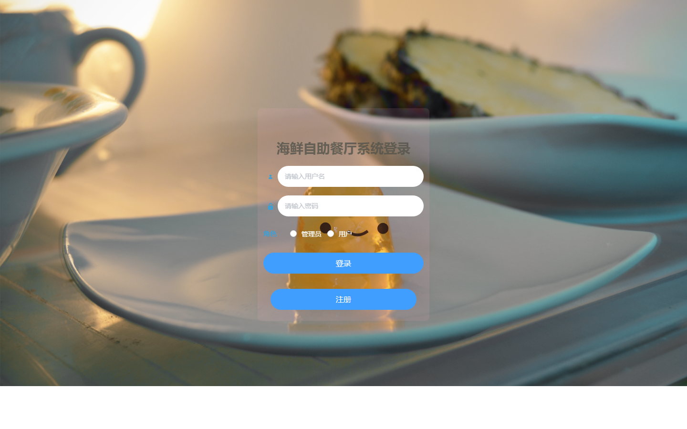

# 海鲜自助餐厅系统 — 操作手册

> 适用系统：zizhuchanting 海鲜自助餐厅系统（v1.0，2026-10-27）
> 读者对象：系统管理员、餐厅服务人员、普通顾客

---

## 1. 系统简介

本系统用于海鲜自助餐厅的日常经营，包含两类使用者：

- **管理员**：维护顾客账号、食物库存、海鲜菜品、餐桌和订单流水；
- **顾客（用户）**：注册登录后预订餐桌、点餐下单、查看并支付订单。

系统访问地址：**http://localhost:8080/zizhuchanting/admin/dist/**

登录页截图：



---

## 2. 系统启动与停止

### 2.1 前提条件

| 依赖 | 本机位置 | 状态要求 |
|---|---|---|
| MySQL 8.0（已导入 `D:\db.sql`） | `C:\Program Files\MySQL\MySQL Server 8.0` | 服务运行中（端口 3306） |
| JDK 1.8 | `C:\Jemeter\JDK1.8` | 已安装 |
| Tomcat 9.0.29 | `D:\apache-tomcat-9.0.29` | 已部署 `zizhuchanting.war` |

### 2.2 启动步骤

1. 启动 MySQL 服务（Windows 服务名一般为 `MySQL80`，或通过 MySQL Workbench 确认能连上）；
2. 启动 Tomcat：
   - **方式一（推荐）**：双击 `D:\apache-tomcat-9.0.29\bin\startup.bat`
     （若报错找不到 JDK，先设置环境变量 `JAVA_HOME=C:\Jemeter\JDK1.8`）；
   - **方式二（看日志排查问题时）**：在命令行执行 `catalina.bat run`，日志直接打印在窗口；
3. 浏览器打开 http://localhost:8080/zizhuchanting/admin/dist/ ，看到登录页即启动成功。

### 2.3 停止步骤

双击 `D:\apache-tomcat-9.0.29\bin\shutdown.bat`（或直接关闭 catalina.bat run 的命令行窗口）。

### 2.4 重新打包部署（改了代码时）

```bash
cd D:\zizhuchanting
set JAVA_HOME=C:\Jemeter\JDK1.8
mvn -DskipTests clean package
# 停止 Tomcat → 删除 webapps\zizhuchanting 目录和 zizhuchanting.war →
# 复制 target\zizhuchanting.war 到 webapps → 再启动
```

---

## 3. 登录与账号

### 3.1 内置账号

| 角色 | 账号 | 密码 | 登录时角色选项 |
|---|---|---|---|
| 管理员 | admin | admin | 管理员 |
| 顾客示例 | 111 | 111 | 用户 |
| 顾客示例 | 222 | 222 | 用户 |

### 3.2 登录

1. 打开系统地址，进入登录页；
2. 输入账号、密码，**勾选对应角色**（管理员 / 用户）——角色选错会提示"权限不正常"；
3. 点击【登录】，进入系统首页。

### 3.3 注册（仅顾客）

登录页点击【注册】→ 填写名称、账号、密码、性别、手机号、头像 → 提交后用新账号以"用户"角色登录。

### 3.4 修改密码

登录后左侧菜单 → 个人中心分组 →【修改密码】，按提示输入原密码与新密码。

> 登录凭证 1 小时后过期，过期后任意操作会提示"请先登录"，重新登录即可。

---

## 4. 管理员操作指南

管理员登录后左侧菜单包含 6 个管理模块。列表页通用操作：

- **查询**：顶部条件输入框（名称/编号等）后点击搜索；
- **新增**：点【新增】按钮，弹出表单填写后保存；
- **查看/修改**：行内【查看】【修改】按钮，弹窗展示，可编辑保存；
- **删除**：勾选行 →【删除】（支持批量）。

### 4.1 用户管理

维护顾客账号。可新增顾客（名称、账号、密码、性别、手机号、头像）、修改、删除。删除顾客不会自动清理其历史订单。

### 4.2 食物库存管理

维护海鲜品种和库存数量（名称 + 数量）。**注意：库存条目 id 同时是"海鲜类型编码"**，海鲜菜品、订单明细都引用它。建议先建库存、再建海鲜菜品；库存数量不足时顾客点餐会被拒绝。

### 4.3 海鲜展示管理

维护餐厅在售海鲜菜品：海鲜名称（下拉，来源于库存表）、单价、图片、描述（富文本）。顾客端"点餐"列表即展示这些数据。

### 4.4 未预定餐桌管理

维护餐桌（名称、位置、是否已预订状态）。新增餐桌默认可被顾客预订。

### 4.5 已预定餐桌管理

查看当前顾客的预订记录（餐桌、用户、预订时间），支持删除（删除即强制释放餐桌）。

### 4.6 流水管理

查看所有订单流水：订单号、餐桌、下单用户、是否支付、总价、时间。可【修改】订单信息；已支付订单由系统在顾客支付时自动更新。

---

## 5. 顾客（用户）操作指南

顾客以"用户"角色登录后，菜单包含：海鲜展示管理（点餐）、未预定餐桌管理（预订）、已预定餐桌管理、订单管理。

### 5.1 第一步：预订餐桌

1. 进入【未预定餐桌管理】，查看空闲餐桌（`sf_types=否` 的为空闲）；
2. 点击行内【预定】按钮 → 该餐桌标记为已预订，并记录在你的名下；
3. 可在【已预定餐桌管理】中查看自己的预订。

> 必须先预订餐桌才能点餐，否则点餐时会提示"请先预定餐桌后再预定菜品"。

### 5.2 第二步：点餐

1. 进入【海鲜展示管理】，浏览海鲜菜品（图片、单价、描述）；
2. 点击行内【点餐】→ 填写每样海鲜的购买数量；
3. 提交后系统自动：
   - 校验库存是否足够（不足会提示"××库存只剩 N 个"）；
   - 生成订单号，写入订单明细与订单流水（状态=未支付）。
4. 进入【订单管理】可看到刚生成的未支付流水（总价、餐桌、时间）。

### 5.3 第三步：支付

在【订单管理】中对自己未支付的流水点击【支付】（即"改wei"操作）：

- 流水状态变为"已支付"；
- 所订餐桌自动释放，预订记录删除，餐桌回到可预订状态。

### 5.4 退出登录

右上角头像/菜单 →【退出登录】（或直接关闭页面；1 小时后登录态自动失效）。

---

## 6. 常见问题（FAQ）

| 现象 | 原因 | 解决办法 |
|---|---|---|
| 提示"请先登录"（401） | 登录超 1 小时或未登录 | 重新登录 |
| 登录提示"权限不正常" | 账号与所选角色不匹配（如 admin 选了"用户"） | 重新选择正确角色 |
| 登录提示"账号或密码不正确" | 密码错误或账号不存在 | 核对 3.1 的内置账号，或请管理员在用户管理中新建 |
| 点餐提示"请先预定餐桌后再预定菜品" | 未预订餐桌 | 先到"未预定餐桌管理"预订 |
| 点餐提示"××库存只剩 N 个" | 库存不足 | 请管理员在库存管理中补货 |
| 页面图片不显示 | `config` 表轮播图仍是旧项目地址（fd-ssmj） | 管理员在数据库 config 表中把图片地址改为当前地址，或重新上传 |
| 上传的图片重启后丢失 | 上传文件保存在 Tomcat webapp 内，重新部署会被覆盖 | 重要图片请另存备份，或改造为外部存储 |
| 打不开系统（连接被拒绝） | Tomcat 未启动 | 按 2.2 启动 Tomcat |
| Tomcat 启动闪退 | JAVA_HOME 未设置 | 设置 `JAVA_HOME=C:\Jemeter\JDK1.8` |
| 页面能开但接口报数据库错误 | MySQL 未启动 / 密码被改 | 启动 MySQL，核对 `src/main/resources/config.properties` 中配置 |

---

## 7. 故障排查速查

1. **看 Tomcat 日志**：`D:\apache-tomcat-9.0.29\logs\catalina.2026-XX-XX.log`（启动错误）、`localhost.2026-XX-XX.log`（应用异常堆栈）；
2. **确认端口占用**：命令行 `netstat -ano | findstr 8080`，若被占用修改 `conf/server.xml` 中 8080 端口；
3. **确认数据库**：用 MySQL Workbench 连 `127.0.0.1:3306`，确认 `zizhuchanting` 库和 `users`、`canzhuo` 等表存在；
4. **重新部署**：任何配置/代码改动后，按 2.4 重新打包部署才生效（`config.properties` 打包在 WAR 内）；
5. **数据库重置**：在 MySQL Workbench 重新执行 `D:\db.sql` 可恢复初始数据（会清空现有数据，谨慎操作）。

---

## 8. 附：默认数据一览

| 数据 | 内容 |
|---|---|
| 管理员 | admin / admin |
| 顾客 | 111/111（小金）、222/222（小札）、123/123 |
| 餐桌 | 1~4 号餐桌（4 号为已预订示例） |
| 海鲜菜品 | 4 条（单价 10~100 元） |
| 库存 | 海鲜1~海鲜4（海鲜1、2 已售空为 0） |
| 历史流水 | 7 条（含已支付与未支付示例） |
